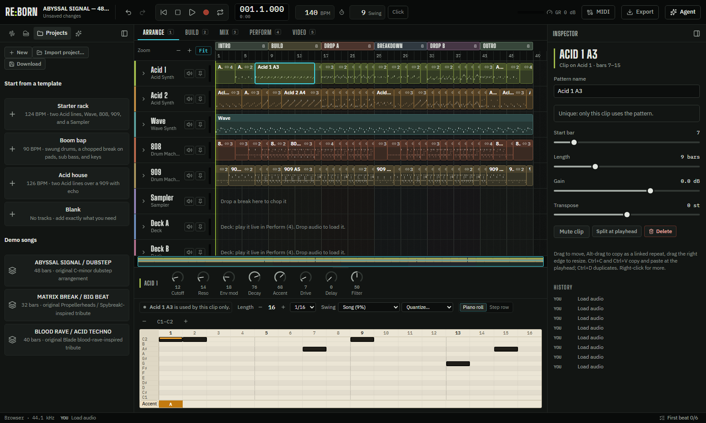
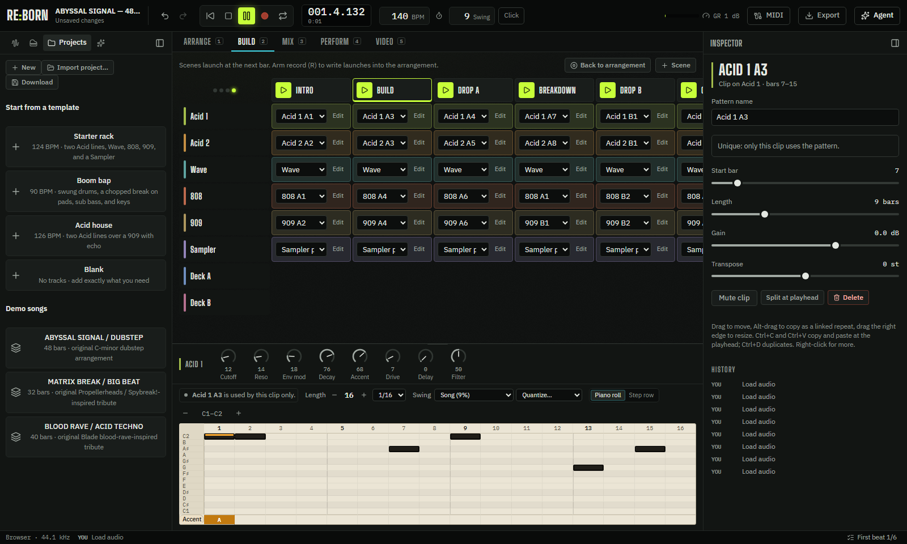
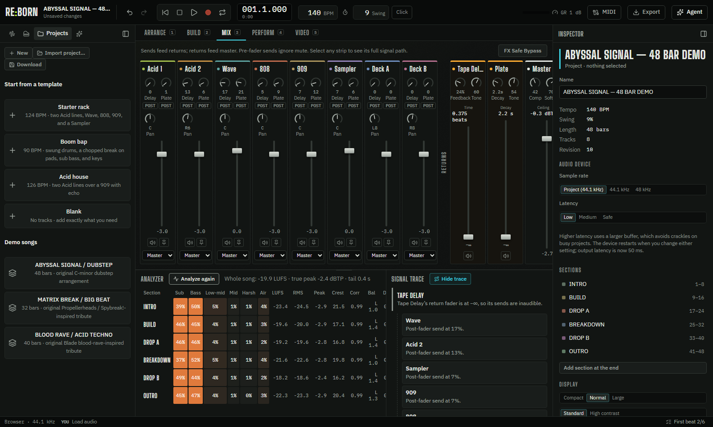
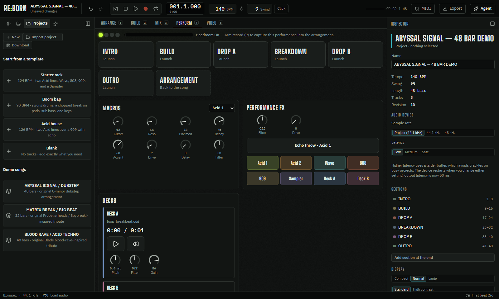

# RE:BORN

[](https://github.com/dawid-ai/reborn/actions/workflows/ci.yml)
[](https://github.com/dawid-ai/reborn/releases/latest)

A desktop music workstation for Windows and Linux. Write acid lines, program drum machines, chop breaks, arrange full songs, mix them, and perform them live. An agent can help through the app, the `reborn` CLI, or MCP.



## Download

- **Windows:** [Download `RE-BORN-Setup.exe`](https://github.com/dawid-ai/reborn/releases/latest/download/RE-BORN-Setup.exe), the latest release for 64-bit Windows 10 and 11. The installer isn't code-signed yet, so Windows SmartScreen asks first: click **More info** > **Run anyway**.
- **Linux:** [Download `RE-BORN-x86_64.AppImage`](https://github.com/dawid-ai/reborn/releases/latest/download/RE-BORN-x86_64.AppImage) for 64-bit Linux, make it executable with `chmod +x RE-BORN-x86_64.AppImage`, and run it. AppImages need FUSE 2: on Arch, install it with `sudo pacman -S fuse2`; on Ubuntu 22.04 and later, `sudo apt install libfuse2t64` (or `libfuse2`).

The app checks for updates at launch and asks before it downloads one. See the [update notes](UPDATES.md) for what changed in each release, and the [releases page](https://github.com/dawid-ai/reborn/releases) for older versions.

## What's inside

- **Devices:** two Acid synths, the Wave synth, 808 and 909 drum machines, a sampler with slicing, audio tracks, and two decks.
- **Five views:** **Arrange** for the song, **Build** for launching scenes live, **Mix** for levels, sends, returns, and groups, **Perform** for macros, effects throws, and decks, and **Video** for music videos cut to the song.
- **Music video:** storyboard a video whose cuts land on the song's real drum hits, risers, and impacts, preview it live, and export an MP4.
- **Mix analysis:** loudness, true peak, and band energy per section, plus a signal trace that explains what you hear.
- **Projects:** project folders with autosave, crash recovery, packing, and WAV and stem export. Projects exported from the earlier RE:BORN web edition open too.
- **MIDI:** play instruments and pads from a controller, and map knobs and buttons with MIDI learn.
- **Agent:** ask for a change or a whole song. Edits arrive as proposals you preview and accept. It works with Claude Code, the Claude API, or a local OpenAI-compatible server such as Ollama.
- **Ismail (optional):** deep analysis, sound generation, and stem separation, installed from inside the app.

| Build | Mix | Perform |
|---|---|---|
|  |  |  |

## Documentation

- [User guide](docs/user-guide.md): first beat, views, sampling, mixing, MIDI, agents, and export.
- [CLI and MCP](docs/cli-and-mcp.md): drive the open project from scripts and agents.

## Run from source

You need Node.js 22 (the version in `.nvmrc`). Deep analysis and the sidecar tests also need Python 3.10 or later with `numpy`.

```bash
npm ci
npm run desktop
```

This builds and starts the desktop app. For UI work, run `npm run studio` and open `http://127.0.0.1:5175`.

Run `npm run build` to type-check and build everything, and `npm test` for unit tests. `npm run dist` builds the installer for the platform you're on into `release/`: `RE-BORN-Setup.exe` on Windows, `RE-BORN-x86_64.AppImage` on Linux. CI runs the unit tests, the sidecar tests, the desktop end-to-end tests, and the installer build on Windows and Linux, plus the studio end-to-end tests and the accessibility and audio audits, on every push. Pushing a `v*` tag publishes both installers to one GitHub release.

## Credits

- Sound generation, stem separation, and the Ismail analysis reports come from [Ismail](https://github.com/newsbubbles/ismail) by Nate Codes (newsbubbles), MIT license. Stem separation runs [Demucs](https://github.com/adefossez/demucs) by Meta, MIT license. The desktop app installs both on request; see [third-party notices](THIRD_PARTY_NOTICES.md).
- Bundled starter audio is CC0; see [its license](apps/studio/public/audio/starter/LICENSE.md).

RE:BORN is an independent project.
