# Look catalog

Generated by `python -m mvkit.catalog`. Every look is a GLSL file in `looks/`; use it in a storyboard scene as `"look": "<name>"` (or as a layer). Parameters can be numbers, `[r,g,b]` lists, or expression strings evaluated every frame (see README).

## Acid Vortex — `acid-vortex`

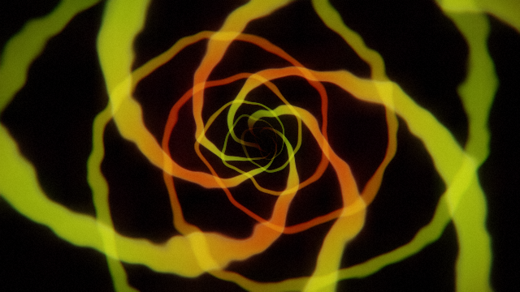

**Fits:** drop, switch-up, heavy  ·  **Mood:** toxic, aggressive, glitchy

Two interlocking logarithmic spirals being sucked inward, warped by noise that grows with the bass. Snares tear the image into horizontal glitch slices.

| param | default | what it does |
|---|---|---|
| `colA` | 0.75,1,0.05 | acid colour |
| `colB` | 1,0.25,0.02 | hot colour |
| `arms` | 5 |  |
| `slices` | 0.25 | glitch slice displacement on snare |
| `base` | 0.6 |  |
| `kickGain` | 1.2 |  |
| `snareGain` | 0.9 |  |
| `punch` | 0.08 |  |

## Footage Grade — `footage-grade`

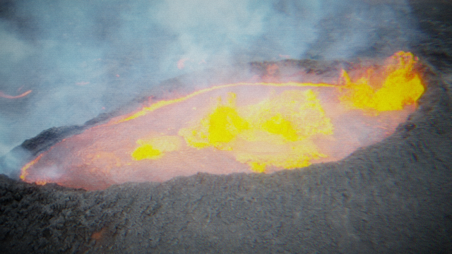

**Fits:** any section with stock footage  ·  **Mood:** cinematic → aggressive, depending on settings

Plays the scene's footage clips (cut on the scene's cutOn events) through a grading stack: saturation/contrast, optional duotone, posterise, zoom punch, RGB split, snare invert and a VHS layer (scanlines, chroma bleed, tracking wobble).

| param | default | what it does |
|---|---|---|
| `sat` | 1 | saturation |
| `contrast` | 1.1 |  |
| `bright` | 1 |  |
| `duo` | 0 | 0 = natural colour, 1 = full duotone |
| `dark` | 0.05,0,0.12 | duotone shadow colour |
| `light` | 1,0.35,0.6 | duotone highlight colour |
| `poster` | 0 | posterise levels (0 = off, try 4-6) |
| `zoom` | 1 | base zoom (1.15-1.2 crops corner watermarks) |
| `punch` | 0.06 | zoom punch on kick |
| `drift` | 0.04 | slow push-in over each clip |
| `split` | 0.004 | RGB split (plus more on kick) |
| `invert` | 0 | invert on snare (0..1) |
| `vhs` | 0.5 | scanlines, chroma bleed, tracking wobble |
| `kickGain` | 0.35 | brightness flash on kick |

## Footage Kaleido — `footage-kaleido`

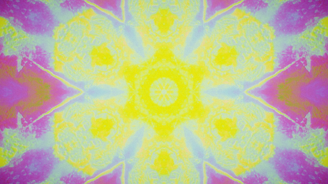

**Fits:** bridge, peak, psychedelic breakdowns  ·  **Mood:** trippy, mirrored, colour-cycling

Folds the footage into a rotating kaleidoscope and cycles its colours. Turns any clip (a face, a crowd, waves) into a mandala.

| param | default | what it does |
|---|---|---|
| `folds` | 6 |  |
| `spin` | 0 | rotation, e.g. "t*.2" |
| `zoom` | 0.8 |  |
| `cycle` | 0.6 | amount of hue cycling |
| `speed` | 0.1 | hue cycle speed |
| `base` | 0.85 |  |
| `kickGain` | 0.5 |  |

## Grid Tunnel — `grid-tunnel`

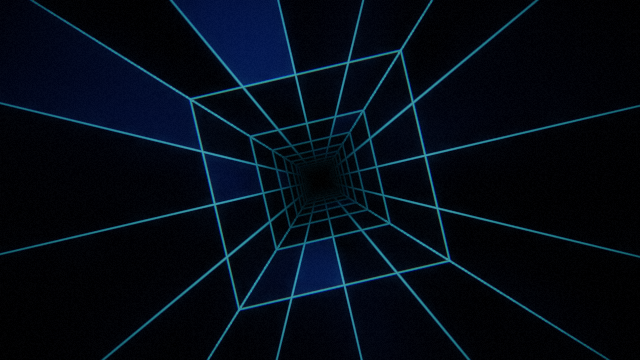

**Fits:** drop, techno, cyber  ·  **Mood:** cold, digital, driving

A square wireframe corridor rushing past, with random panels lighting up on the bass and a bright wavefront on every kick.

| param | default | what it does |
|---|---|---|
| `line` | 0.25,0.85,1 | line colour |
| `panel` | 0.1,0.35,0.9 | panel colour |
| `twist` | 0.12 | corridor roll speed |
| `base` | 0.7 |  |
| `snareGain` | 0.7 |  |
| `punch` | 0.07 |  |

## Julia Drift — `julia-drift`

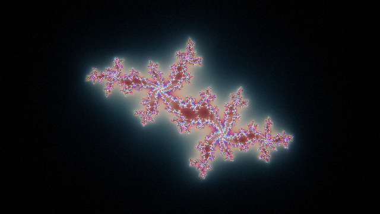

**Fits:** intro, build, outro, breakdown  ·  **Mood:** bright, sparse, floating; dive mode for builds

A Julia set fractal that drifts and slowly morphs. Animate `zoom` toward 0 with an expression to dive into it for a build-up. Brightness auto-normalises while zooming (engine hook computes `off`).

| param | default | what it does |
|---|---|---|
| `cAngle` | 2.25 | Julia constant c = 0.7885*e^(i*cAngle). 2.2-2.45 dendrites, 1.6-1.85 & 2.3 connected spirals, 3.0+ basilica |
| `center` | 0,0 | point the camera looks at (complex plane) |
| `zoom` | 1.6 | half-height of view in the complex plane; smaller = deeper |
| `rot` | 0 | view rotation (radians) |
| `iters` | 140 | max iterations (raise when zooming deep) |
| `hue` | 0.55 | palette phase |
| `warp` | 0.25 | gentle domain-warp wobble |
| `palA` | 0.55,0.5,0.6 |  |
| `palB` | 0.45,0.45,0.4 |  |
| `palC` | 1,1,1 |  |
| `palD` | 0,0.15,0.25 |  |
| `pump` | 0 | brightness pump on kick (0..1) |

## Neon Kaleido — `neon-kaleido`

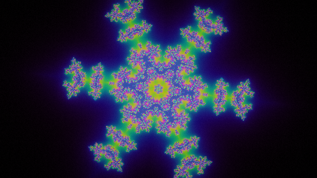

**Fits:** drop, peak, bridge, build  ·  **Mood:** psychedelic, symmetrical, colourful

A kaleidoscope folded Julia fractal. The Julia constant wobbles with the bass so the shape breathes with a Reese/wobble bass; colour hue steps every few beats. Calm settings make a mandala for bridges; fast spin + strobe make a build.

| param | default | what it does |
|---|---|---|
| `folds` | 6 | kaleidoscope segments |
| `spin` | 0 | rotation (radians) – use an expression like "t*.15" |
| `zoom` | 1.25 |  |
| `cAngle` | 2.5 |  |
| `wobble` | 0.045 | how much the bass bends the fractal |
| `iters` | 72 |  |
| `hue` | 0 |  |
| `palD` | 0.85,0.15,0.55 | palette phase offsets (0,0.33,0.67 = rainbow) |
| `base` | 0.55 | brightness between hits |
| `kickGain` | 1.1 |  |
| `snareGain` | 0.8 |  |
| `punch` | 0.09 |  |

## Shock Ring — `shock-ring`

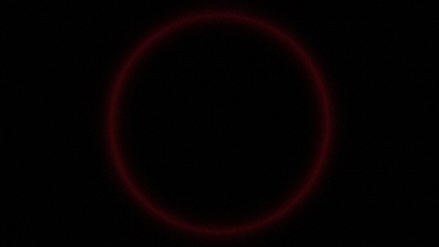

**Fits:** layer: drops, impacts  ·  **Mood:** punchy

Layer. An expanding ring fired by every kick.

| param | default | what it does |
|---|---|---|
| `color` | 1,0.2,0.3 |  |
| `speed` | 2.2 |  |
| `width` | 14 |  |

## Star Sparkle — `star-sparkle`

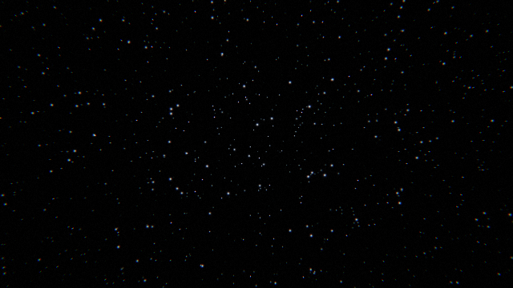

**Fits:** layer: intro, bells, hats, any  ·  **Mood:** twinkling, airy

Layer. A field of twinkling points that flare with the hi-hats (uHat) and the air band. Use as an additive layer over any look.

| param | default | what it does |
|---|---|---|
| `density` | 0.12 |  |
| `color` | 0.75,0.85,1 |  |
| `gain` | 1.1 | extra brightness with hats |
| `spin` | 0.02 |  |

## Strobe Deck — `strobe-deck`

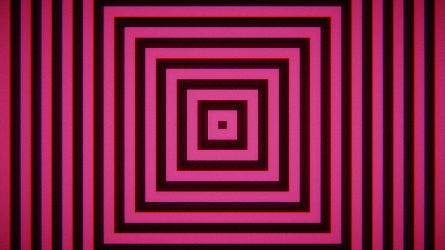

**Fits:** switch, breakdown, transition  ·  **Mood:** frantic, graphic, high-contrast

Hard-cuts to a different graphic on every cut event (set the scene's cutOn, e.g. kick+snare or beat): inverted fractal silhouette, square rings, acid oscilloscope, ray burst, negative veins, shock ring. Each cut flashes then decays like a strobe.

| param | default | what it does |
|---|---|---|
| `decay` | 4 | strobe decay speed after each cut |
| `floor` | 0.25 | brightness the strobe decays to |
| `seed` | 0 | shuffles the variant order |
| `tint` | 1,1,1 |  |

## Vein Tunnel — `vein-tunnel`

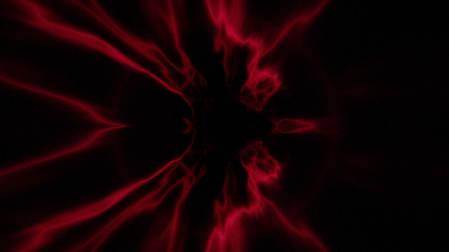

**Fits:** drop, heavy  ·  **Mood:** dark, heavy, organic, pulsing

Flying down a black tunnel of glowing veins. Veins fatten with the bass envelope, the camera lunges on kicks (set the scene's travel), and the image punches on kick/snare with a shock ring.

| param | default | what it does |
|---|---|---|
| `thickLo` | 22 | vein sharpness when bass is quiet (higher = thinner) |
| `thickHi` | 9 | vein sharpness at full bass |
| `colA` | 0.35,0.02,0.25 | dim body colour |
| `colB` | 0.85,0.05,0.18 | vein colour |
| `colSnare` | 1,0.45,0.15 | vein colour on snare hits |
| `base` | 0.3 | brightness between hits |
| `kickGain` | 1.4 |  |
| `snareGain` | 1 |  |
| `punch` | 0.07 | zoom punch on kick |
| `ring` | 0.6 | shock ring strength |

## Wave Ring — `wave-ring`

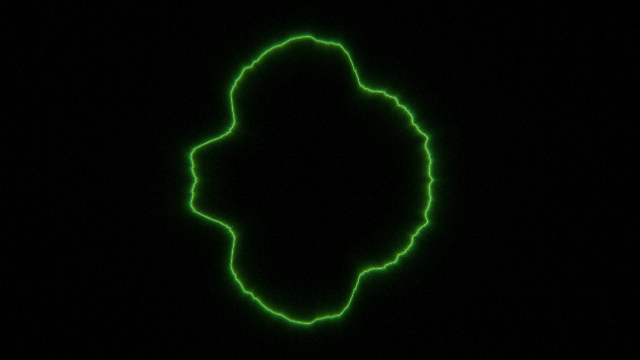

**Fits:** layer: acid, lead, bridge  ·  **Mood:** live, oscilloscope

Layer. The actual audio waveform drawn as a glowing circle (mirrored so it has no seam). Great for showing an acid line or lead entering.

| param | default | what it does |
|---|---|---|
| `radius` | 0.55 |  |
| `amp` | 0.25 |  |
| `color` | 0.4,1,0.3 |  |
| `cycle` | 0 | >0 cycles the colour through a rainbow at this speed |
